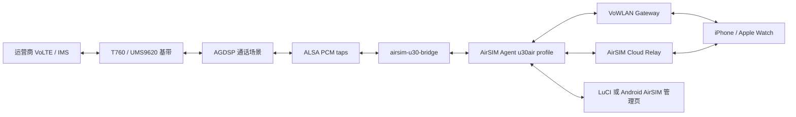
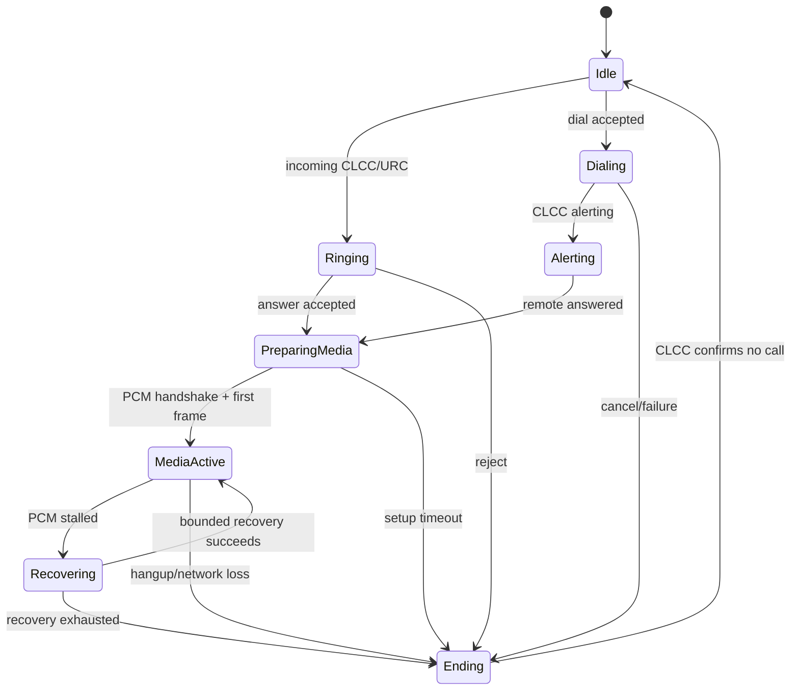

# U30 Air 接入 AirSIM 设计

状态：设计基线  
日期：2026-10-22

## 1. 目标与结论

U30 Air 可以作为 AirSIM 的第三种蜂窝终端，与现有 QDC507/DJOneHub 模块端和 Android Standalone 端并列：

| 终端 | 呼叫控制 | 音频来源 | 设备侧运行环境 |
| --- | --- | --- | --- |
| DJOneHub/QDC507 | AT/DATA11 | QDC507 voice bridge | 模块 Linux |
| Android AirSIM | Android Telecom | Shizuku `TYPE_TELEPHONY` PCM | Android APK |
| U30 Air | 展锐 AT/CLCC | UMS9620 AGDSP/ALSA PCM | OpenWrt；后续支持 Root Android |

AirSIM 的 iPhone、Apple Watch、CallKit、PushKit、Cloudflare Relay、VoWLAN、呼叫所有权和 `legacy_pcm/djpm1` 协议保持不变。新增一个 `u30air` runtime profile、一个 U30 Air 语音桥以及对应的安装包即可完成接入。

首个正式实现采用 OpenWrt 插件。Android APK 采用相同上层协议，但需要匹配 U30 Air 原厂 Android 内核的音频驱动、AGDSP 保留内存和 Root 启动服务，不能只靠普通 APK 完成。

已安装 UFI-TOOLS 的 Android 机器，用插件替代 APK 的管理页职责，其余（Agent 协议、PCM、Root 模块、更新原则）与本文一致，见 [UFI-TOOLS 插件附录](UFITOOLS_PLUGIN_DESIGN.md)。

## 2. 可复用的现有 AirSIM 契约

U30 Air 适配必须保持下面的现有行为，以免 iOS、Watch 和 Relay 出现设备类型分支。

### 2.1 呼叫与设备 API

设备侧继续提供现有 Agent 路由：

```text
GET  /api/health
GET  /api/calls/status
GET  /api/calls/events
POST /api/calls/dial
POST /api/calls/answer
POST /api/calls/reject
POST /api/calls/hangup
POST /api/calls/dtmf
POST /api/calls/audio/mute
GET  /api/sms
POST /api/sms/send
```

`answer`、`reject` 和 `hangup` 接受当前 `call_id`。U30 Air 适配层必须拒绝已经过期或不匹配的 ID，防止重连后的旧命令误操作下一通电话。

### 2.2 媒体协议

设备与 AirSIM Agent 之间继续使用：

```text
握手：AIRSIMPCM1\n → AIRSIMREADY
格式：PCM S16LE
采样率：8000 Hz
通道：mono
帧长：20 ms
负载：320 bytes
```

云端继续支持 raw `legacy_pcm` 和带序号、时间戳的 `djpm1`。Relay 只转发二进制帧，不执行转码。首版不引入 WebRTC，以便直接复用现有 iOS 媒体引擎、Relay 隔离和恢复逻辑。

### 2.3 呼叫身份与所有权

每通电话继续携带：

- `call_id`：设备端本次基带呼叫的稳定标识；
- `call_uuid`：AirSIM 全链路 UUID；
- `trace_id`：诊断关联标识；
- `generation`：同一设备的递增通话代次；
- `owner`：当前取得接听与媒体权的 iPhone/Watch 客户端。

云端命令沿用幂等键、设备绑定和 owner claim。Agent 重连只能恢复同一个 `call_uuid`，不能把旧媒体套到新呼叫上。

## 3. 总体架构



设备端拆为两个长期进程：

1. `airsim-u30-bridge` 只处理 AT、AGDSP、ALSA、重采样和本机 PCM socket。
2. `airsim-agent` 处理 AirSIM API、设备身份、配对、Push/Relay、呼叫状态机和媒体编排。

这样能让 U30 Air 的硬件逻辑与 AirSIM 产品逻辑分开。音频桥崩溃时 Agent 可以清楚报告设备后端故障，并执行有界恢复；Agent 更新也不需要重新构建内核音频驱动。

## 4. U30 Air 硬件适配

### 4.1 AT 控制

OpenWrt 版本通过 `mu300-atd`/`mu300-at` 使用独占、串行化的 AT 通道。桥接进程不直接和 LuCI、短信服务争抢串口。

首版命令映射：

| AirSIM 动作 | U30 Air 动作 |
| --- | --- |
| 查询呼叫 | `AT+CLCC`，并消费可用呼叫 URC |
| 外呼 | `ATD<number>;` |
| 接听 | `ATA` |
| 拒接/挂断 | `ATH`，失败时 `AT+CHUP`，随后用 `AT+CLCC` 确认 |
| DTMF | 通话音频场景运行后逐键 `AT+VTS` |
| IMS 状态 | IMS PDP/注册状态与实际呼叫结果共同判断 |
| 短信 | 复用 mu300-linux 的短信池与发送接口 |

`AT+CLCC` 映射为 AirSIM 状态：

| CLCC state | AirSIM state |
| --- | --- |
| 0 | `active` |
| 1 | `held` |
| 2 | `dialing` |
| 3 | `alerting` |
| 4 | `incoming` |
| 5 | `waiting` |

呼叫索引可能被基带复用，因此 `call_id` 由 `boot_id + generation + CLCC index` 派生，不能只使用 CLCC index。

### 4.2 AGDSP 与 PCM

首版依赖 `mu300-audio` 的 audio extra，并在安装后检查：

```sh
mu300-audio-dsp status
mu300-voice status
```

U30 Air 的三个音频端点承担不同职责：

| 端点 | 原始格式 | 用途 |
| --- | --- | --- |
| `FE_ST_VOICE` | 8 kHz mono，双向 hostless | 维持 DSP 通话场景 |
| `FE_ST_DUMP` | 48 kHz stereo，两声道相同 | 读取远端下行语音 |
| `FE_ST_VOICE_PCM_P` | 16 kHz mono | 写入远端要听到的上行语音 |

`airsim-u30-bridge` 的媒体管线：

```text
下行：FE_ST_DUMP 48k stereo
   → 取单声道
   → 低通滤波
   → 48k → 8k 重采样
   → 160 samples / 20 ms
   → AirSIM PCM

上行：AirSIM PCM 8k mono
   → 抖动缓冲
   → 8k → 16k 重采样
   → FE_ST_VOICE_PCM_P
```

写入流必须持续。没有客户端语音时写静音帧，避免 underrun；一旦 PCM stream 停止就关闭并重新打开，不能在同一 stream 上执行危险的重复 prepare/start。桥接进程负责限长队列、丢弃过旧帧、峰值/帧数统计和 xrun 诊断，绝不记录 PCM 内容。

### 4.3 本机 PCM 服务

桥接进程只监听 loopback，例如 `127.0.0.1:7580`。新的 `u30air` voice backend 允许该 loopback 地址，但只在 `u30air-openwrt` 或 `u30air-android` runtime profile 下启用。LAN 和蜂窝 WAN 都不能直接访问原始 PCM 端口。

## 5. AirSIM Agent 改造

现有 Go Agent 已包含 `android-avf` 和未启用的 `qdc507` profile。实现时增加：

```text
AIRSIM_RUNTIME_PROFILE=u30air-openwrt
AIRSIM_VOICE_BACKEND=u30air
AIRSIM_U30_PCM_ADDRESS=127.0.0.1:7580
AIRSIM_DATA_DIR=/var/lib/airsim
```

新的 profile 属性：

| 属性 | 值 |
| --- | --- |
| `Platform` | `u30air-arm64-openwrt` |
| `RequiresModem` | true |
| `DirectModule` | true |
| `CallAudio` | true |
| `AndroidTelecom` | false |
| `NativeContacts` | false |
| `WRTLite` | false |

Agent 需要把当前写死的 QDC507 条件提取为设备后端接口：

```go
type DeviceBackend interface {
    Health(ctx context.Context) DeviceHealth
    Calls(ctx context.Context) ([]Call, error)
    Dial(ctx context.Context, number string) error
    Answer(ctx context.Context, callID string) error
    Reject(ctx context.Context, callID string) error
    Hangup(ctx context.Context, callID string) error
    DTMF(ctx context.Context, callID, keys string) error
    SendSMS(ctx context.Context, number, text string) error
    PCMEndpoint(ctx context.Context) (string, error)
}
```

现有 Android Telecom 后端、QDC507 AT 后端和 U30 Air 后端都实现这一接口。Relay、Push、API handler 和 iOS 协议只依赖接口，不再判断具体设备。

## 6. VoWLAN 与配对

U30 Air 没有屏幕，配对码在 LuCI 或 Android 管理网页中显示。

配对继续使用 AirSIM 现有协议：

- Bonjour：`_airsim-pair._tcp.local.`；
- 120 秒配对窗口；
- X25519 + HKDF-SHA256；
- 六位确认码参与密钥派生；
- AES-256-GCM 封装注册数据；
- 配对成功后窗口立即失效。

正常本地通话公布 `_airsim-vowlan._tcp.local.`。U30 Air 的热点地址通常是 `192.168.78.1`，但客户端只能把它当发现结果，不能硬编码。

VoWLAN Gateway 绑定 `br-lan` 当前私有地址，只开放健康、通话控制、DTMF、短信发送和 PCM。每个请求继续校验 HMAC、时间戳、nonce、请求体摘要和路由白名单。原始 AT、系统更新、Shell、LuCI 管理接口不进入 VoWLAN API。

每通电话开始前选择 `vowlan` 或 `cloud`，并锁定到结束。通话中不迁移路径。

## 7. 呼叫状态机与失败策略



AirSIM 原有媒体里程碑保持顺序：

```text
answer_ok → pcm_listening → active → pcm_ready → pcm_first_frame
```

U30 Air 没有本机听筒和麦克风，因此媒体持续故障时没有 Android 手机那样的本机回切路径。处理策略是：

1. 先保留 DSP call scene，重连本机 PCM；
2. 最多执行三次有界媒体重建；
3. VoWLAN 链路断开或云端媒体超过设定窗口仍未恢复时挂断蜂窝通话；
4. 发布明确的终止原因，避免产生一通无人能够听见的计费电话。

## 8. 安装形态

### 8.1 OpenWrt 插件，首发目标

软件包拆分为：

| 包 | 内容 |
| --- | --- |
| `airsim-u30-core` | `airsim-agent`、`airsim-u30-bridge`、procd 服务、UCI 配置 |
| `airsim-u30-audio` | `mu300-audio` 集成、DSP/PCM 健康检查、版本绑定 |
| `luci-app-airsim` | 配对、通话状态、Relay、客户端、诊断和更新 UI |
| `luci-i18n-airsim-zh-cn` | 中文翻译 |

在线安装流程：

```sh
sudo mu300-extra install audio
apk add airsim-u30-core airsim-u30-audio luci-app-airsim luci-i18n-airsim-zh-cn
/etc/init.d/airsim-u30-bridge enable
/etc/init.d/airsim-agent enable
/etc/init.d/airsim-u30-bridge start
/etc/init.d/airsim-agent start
```

LuCI 首次向导依次完成：设备检测、音频自检、Relay 配置、两分钟配对、VoWLAN 验证和测试呼叫。服务默认只允许 LAN 管理，WAN 不开放 LuCI、Agent API 或 PCM。

### 8.2 Android AirSIM APK，第二阶段

Android 形态由一个用户可见 APK 和一个 Root 配套模块组成：

```text
AirSIM-U30.apk
  ├─ 管理网页/配对/状态/升级入口
  ├─ 内置 AirSIM Agent 产品逻辑
  └─ Root 模块安装与健康检查客户端

airsim-u30-root-module
  ├─ airsim-u30-bridge
  ├─ 音频驱动与 AGDSP 服务
  ├─ init 启动项
  └─ 最小 SELinux/设备节点规则
```

APK 在无屏设备上提供 LAN Web 管理页，并可由另一台手机浏览器访问。它不申请默认拨号器角色，因为 U30 Air 直接使用 AT 控制基带，不依赖 Android Telecom。

安装器必须按 `设备型号 + 固件版本 + uname -r + kernel config hash` 选择音频模块。原厂 Android 没有 mu300-linux 已准备好的音频内核环境，所以 Android 版本只有在以下项目完成后才能发布：

- U30 Air 原厂 Android boot 的 AGDSP reserved-memory 补丁；
- 与准确内核构建匹配的音频模块；
- Root/KernelSU 或 Magisk 启动服务；
- A/B boot 备份与失败回滚；
- U30 Air 真机完整双向通话验证。

Android 和 OpenWrt 共享 Agent 协议、设备身份格式、配对逻辑、Relay 和 iOS 客户端；只有进程管理、配置目录和音频驱动加载不同。

## 9. 更新与回滚

沿用 DJOneHub Bootstrap 和 AirSIM installerd 已验证的发布原则：

- Ed25519 签名 manifest；
- HTTPS host 白名单；
- 平台和内核指纹严格匹配；
- 下载长度、SHA-256、包内文件白名单和权限校验；
- 同一文件系统暂存并通过 rename 激活；
- 新版本健康检查通过后才删除旧版本；
- 失败自动恢复旧目录；
- 日志和更新状态不包含 IMEI、号码、短信正文或认证材料。

OpenWrt 包平台标识为 `u30air-arm64-openwrt-25.12`，音频包还必须绑定 mu300-linux release 和 kernel config hash。Android boot/root 模块使用独立更新通道，不能跟普通 APK 静默混装。

## 10. 代码布局建议

```text
U30Air/
├── cmd/
│   ├── airsim-u30-bridge/
│   └── airsim-u30-diagnose/
├── internal/
│   ├── modem/          # AT/CLCC/URC/SMS
│   ├── audio/          # ALSA、DSP、resample、20 ms framing
│   ├── pcmserver/      # AIRSIMPCM1/AIRSIMREADY
│   └── health/         # capability and failure reasons
├── packaging/
│   ├── openwrt/
│   └── android-root/
├── luci-app-airsim/
├── android-manager/
└── docs/
```

AirSIM 主仓库中的改动控制在：runtime profile、device backend 接口、U30 voice backend、发布平台与测试夹具。设备专用驱动、DSP 管理和打包留在本仓库。

## 11. 实施阶段

### Phase 0：U30 Air 音频事实验证

- 在真实 U30 Air 上安装 mu300-linux 与 audio extra；
- 验证 IMS/VoLTE 注册、呼入、呼出、接听、挂断和 DTMF；
- 验证 `FE_ST_DUMP` 连续下行、`FE_ST_VOICE_PCM_P` 连续上行；
- 完成 20 次短通话和一次 30 分钟通话；
- 记录 U30 Air 与已验证 F50 的差异。

通过条件：双向语音在 U30 Air 上真实可听，且重启后可重复。

### Phase 1：本机 Bridge MVP

- 实现 AT backend 与稳定 call ID；
- 实现 ALSA 双向重采样；
- 实现 loopback PCM server 和握手；
- 提供 `diagnose`、帧计数、峰值和故障码；
- 在本地测试客户端完成拨号、接听和双向 PCM。

### Phase 2：AirSIM Agent profile

- 提取 `DeviceBackend`；
- 增加 `u30air-openwrt` profile；
- 接入现有 Relay、Push、owner claim、`djpm1` 和恢复逻辑；
- 保持 iOS/Watch API 与数据结构不变。

### Phase 3：VoWLAN 与 LuCI

- 实现 LuCI 两分钟配对窗口；
- 实现 U30 Air 热点上的受限 HMAC Gateway；
- 接入 Bonjour 发现；
- 验证本地拨号、来电和双向音频完全不经过 Relay。

### Phase 4：OpenWrt 发布

- 生成签名 `.apk` 软件包与离线安装包；
- 实现升级、健康检查和回滚；
- 完成断网、重启、Agent 崩溃、DSP 崩溃和内核切换测试；
- 发布 U30 Air 专用安装说明。

### Phase 5：Android APK/Root 模块

- 移植相同 bridge 到 Root Android；
- 完成匹配 boot 和音频模块构建；
- APK 提供无屏 Web 管理、配对与更新；
- 完成 A/B boot 回滚和原厂系统兼容验证。

## 12. 验收标准

| 范围 | 验收标准 |
| --- | --- |
| 呼叫控制 | 呼入、呼出、接听、拒接、挂断、DTMF 均由当前 `call_id` 精确控制 |
| 本地媒体 | 上下行连续，静音时不 underrun，30 分钟无 PCM 冻结 |
| 首帧 | 热路径 P95 小于 3 秒，任何一次不超过 8 秒；冷路径 20 秒内成功或给出具体阶段错误 |
| VoWLAN | 同一热点完整通话不使用 Relay；断开热点后本次通话结束，下一通重新选路 |
| 云端 | Push 唤醒、owner claim、双向 PCM、重连与挂断保持现有 AirSIM 行为 |
| 多客户端 | 只有 owner 能发送上行；其他客户端只接收允许的状态或监听流 |
| 安全 | 未配对 LAN 客户端不能控制呼叫或打开 PCM；WAN 无管理和本机 PCM 监听 |
| 恢复 | Agent/Bridge 重启可恢复 idle 状态；活跃通话恢复失败时有界挂断，不遗留基带呼叫 |
| 更新 | 错平台、坏签名、坏摘要、缺文件和健康失败均拒绝或回滚 |

## 13. 首个版本范围

`v0.1` 只包含：

- U30 Air + mu300-linux OpenWrt；
- 单 SIM、单路活动 VoLTE 通话；
- iPhone 端拨号、来电、接听、拒接、挂断、DTMF；
- VoWLAN 与现有 AirSIM Relay 两条路径；
- 8 kHz PCM 和 `djpm1`；
- 短信发送与新短信事件；
- LuCI 配对、状态、自检和日志导出。

Android APK、并发呼叫、通话中 VoWLAN/Cloud 迁移、WebRTC、录音和 AI 实时语音处理不进入 `v0.1`。Agent 可以订阅通话状态、转写结果和工具事件，但实时 PCM 始终由确定性的媒体进程处理。
